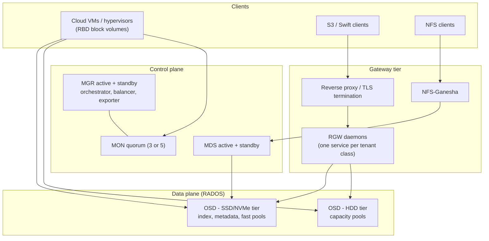
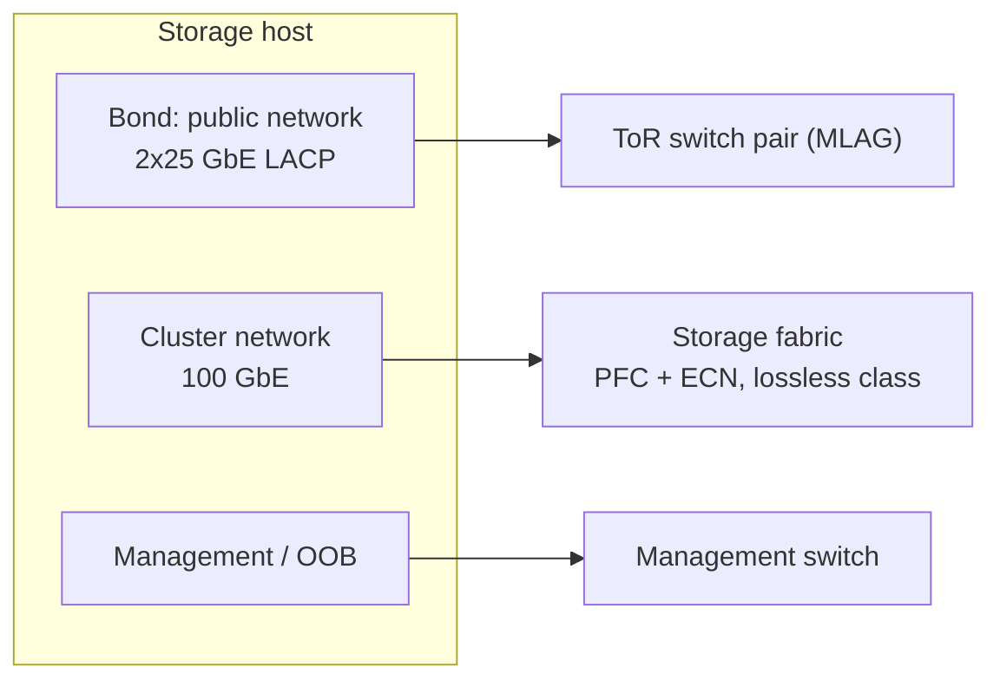

# Ceph Storage Platform

A multi-cluster Ceph platform that serves block (RBD), object (S3/Swift via RGW) and file
(CephFS, NFS) storage to a public cloud.

**Scale operated:** 10+ production clusters; the largest with ~800–1,000 OSDs across dozens of hosts,
mixed HDD and SSD/NVMe tiers, 100 GbE storage networking.

## Topology

## Design decisions

| Area | Approach |
|---|---|
| Deployment | `cephadm` with containerized daemons; placement by host labels (`mon`, `mgr`, `osd`, `rgw`, `mds`) |
| Failure domains | CRUSH hierarchy root → rack → host; separate CRUSH roots for HDD and SSD device classes |
| Data protection | 3× replication for latency-sensitive pools; erasure coding (e.g. 4+2, 6+2) for capacity pools |
| Pool layout | RGW index and CephFS metadata on SSD; bulk data on HDD |
| Networking | Separate public and cluster (replication) networks; LACP bonds; lossless RoCEv2 (PFC + ECN/DCQCN) on 100 GbE rails |
| Object gateway | Multiple RGW services isolated by port and placement, behind a reverse proxy for TLS |

## Network

## Operations I run

- **Build:** hardware/BIOS baseline, OS tuning, bootstrap with `cephadm`, acceptance testing with `fio` and `rados bench`.
- **Lifecycle:** add/remove OSDs and hosts, expand MON quorum, host maintenance mode, failed-disk replacement.
- **Data movement:** controlled reweighting, backfill/recovery throttling, balancer tuning to avoid client impact.
- **Upgrades:** rolling, one failure domain at a time, with health gates between steps.
- **Health:** start-of-shift checks (`ceph -s`, PG states, slow ops, capacity per root), alert triage flow.
- **Incidents:** e.g. false-positive OSD "down" events causing slow ops and inactive PGs; investigated
  heartbeats, network and host logs, wrote a postmortem and runbook.

## Monitoring

`ceph-exporter` + `node-exporter` on every host → Prometheus → Grafana dashboards and Alertmanager.
Key signals: health status, PG states, slow ops, OSD up/in, capacity and fill ratio per CRUSH root,
recovery throughput, disk latency, NIC errors and PFC pause frames.
