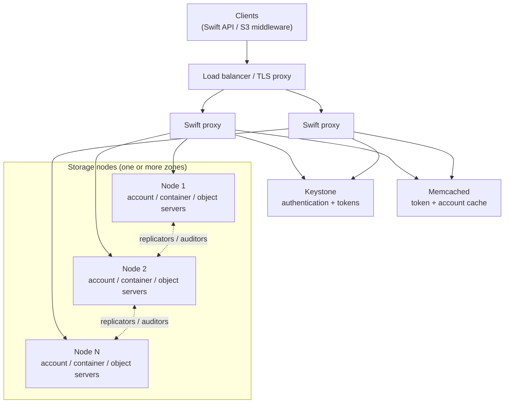

# OpenStack Swift Object Storage

An object storage cluster based on OpenStack Swift, with Keystone for identity. I have built it as
an all-in-one setup for dev/staging and as a multi-node setup for internal production use.

## Topology

## Design decisions

| Area | Approach |
|---|---|
| Rings | Separate account, container and object rings; partition power sized for long-term growth |
| Durability | 3 replicas spread across zones (hosts or racks) |
| Disks | XFS-formatted data disks mounted per device; container/account DBs on SSD where possible |
| Auth | Keystone with service users per consumer project |
| Scaling | Stateless proxies scale out behind the load balancer; storage scales by adding devices to the rings |

## Operations I run

- Installation of Keystone, proxies and storage nodes; ring creation and rebalancing.
- Adding capacity: add devices with gradual weight increase, rebalance, push rings to all nodes.
- Failed-disk handling: unmount, remove from rings or set weight to 0, replace, re-add.
- Debugging: proxy and object-server logs, `swift-recon` for replication and disk health,
  `swift-get-nodes` to trace where an object lives.
