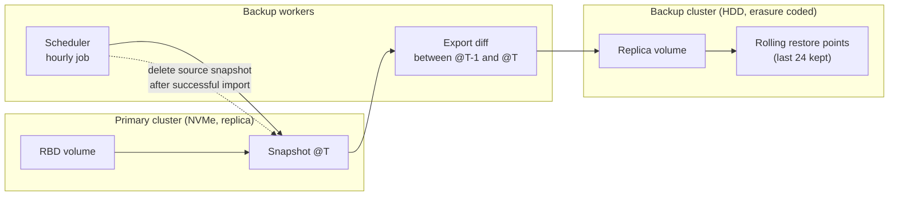

# Cross-Cluster Block Backup & Disaster Recovery

Backup of block volumes from a fast primary Ceph cluster to a cheaper, larger backup cluster using
incremental RBD snapshots, plus a worker-based backup service for customer workloads.

**Scale operated:** hundreds of TB on the primary (NVMe, replica 2) backed up to a larger HDD
cluster (erasure coding 6+2), with hourly restore points.

## Data flow

## Backup logic

1. **First run:** full export of each volume to the backup cluster.
2. **Every hour:**
   - create a snapshot on the primary;
   - export only the changes since the previous snapshot and import them on the backup cluster;
   - delete the source snapshot once the import is confirmed;
   - keep the latest 24 snapshots on the backup cluster and prune older ones.
3. **Restore:** roll back or clone from any kept snapshot, then export back to the primary or attach directly.

## Design decisions

| Area | Approach |
|---|---|
| Cost | Primary on NVMe replica 2 for performance; backup on HDD erasure coding 6+2 for capacity |
| Consistency | Snapshot-based, so each restore point is a crash-consistent image |
| Failure handling | Source snapshot is removed only after a confirmed import; failed runs retry from the last good snapshot |
| Isolation | Backup runs on dedicated workers, not on storage nodes |
| Visibility | Job duration, size of each diff, success/failure and lag exported to Grafana dashboards with alerts |

## Operations I run

- Setting up and scaling backup workers.
- Restoring customer volumes on request and in incidents.
- Dashboards and alerts for missed or slow backups.
