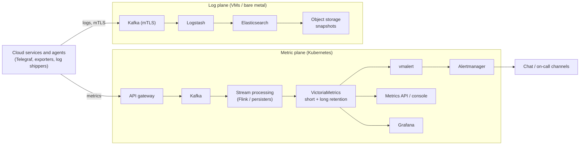
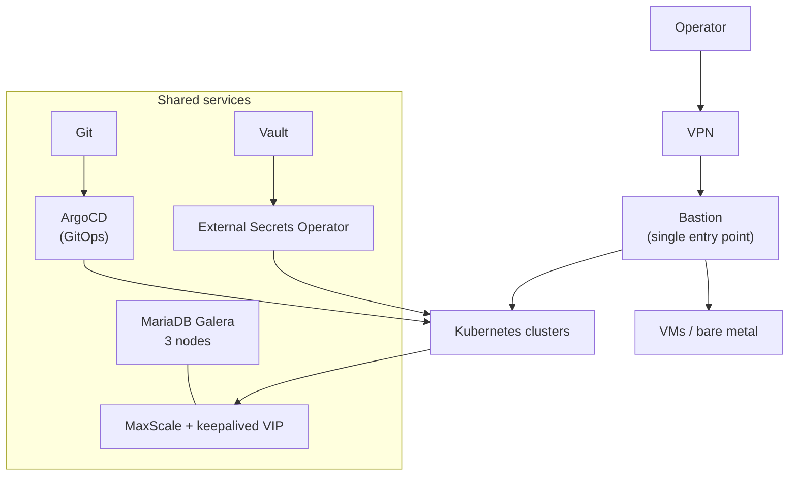

# Observability Platform for a Public Cloud

The monitoring and logging platform that collects metrics and logs from every service of a public
cloud (compute, load balancer, storage, networking) and serves dashboards, alerts and a metrics API.

**Scale operated:** tens of millions of active time series; multiple VictoriaMetrics instances;
a dedicated log plane with Kafka and Elasticsearch.

## Overview

## Platform services

## Design decisions

| Area | Approach |
|---|---|
| Ingestion | Kafka buffers between producers and storage, so storage outages do not lose data |
| Metrics storage | VictoriaMetrics, split by product and retention (short for high resolution, long for trends) |
| Alerting | vmalert rules → Alertmanager routing → chat channels per team |
| Logs | Separate plane with mTLS on ingestion; Elasticsearch with snapshots to object storage |
| Deployment | GitOps with ArgoCD; secrets from Vault through External Secrets Operator |
| Metadata DB | MariaDB Galera cluster behind MaxScale with a floating VIP |
| Access | VPN + bastion only; read-only accounts for audits |

## Work I have done on it

- **Production audit:** read-only review of architecture, capacity, security and alerting;
  findings turned into change proposals with risk, rollback and owner.
- **Capacity analysis:** found that a few high-cardinality histogram metrics made up about two
  thirds of all active series. Dropping them is cheaper than cutting retention. Built repeatable
  tooling to measure disk growth.
- **Daily health checks** and an incident library with triage steps.
- **Onboarding documentation** that takes a new engineer from zero to on-call in a week.
- **Log-pattern alerting** service that scans logs for known error patterns and notifies chat.
