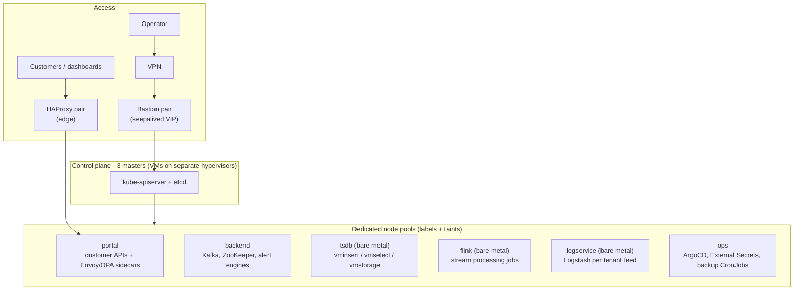
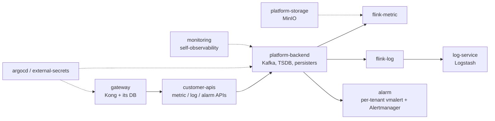

# Kubernetes Cluster for the Observability Platform

The production Kubernetes cluster that runs the metric plane of the observability platform described in
[04-observability-platform.md](04-observability-platform.md): ingestion APIs, Kafka, stream processing,
time-series storage, alerting and the customer-facing APIs.

**Scale operated:** ~30 nodes (VMs and bare metal), a dozen namespaces, tens of stream-processing
jobs, a multi-tenant alerting layer, and tens of millions of active time series.

## Cluster layout

## Stack

| Layer | Components |
|---|---|
| Cluster | kubeadm, CRI-O, Calico CNI, 3-node stacked etcd |
| Infrastructure | Control plane and light pools on VMware ESXi VMs; heavy pools (TSDB, Flink, Logstash) on bare metal |
| Ingress / API | Kong gateway + Kong Ingress Controller; Envoy sidecars with OPA for authorization on customer APIs |
| Messaging | Kafka + ZooKeeper as the buffer between ingestion and processing |
| Stream processing | Apache Flink on Kubernetes via the Flink Kubernetes Operator (metric and log jobs) |
| Time-series storage | VictoriaMetrics cluster (vminsert / vmselect / vmstorage) managed by the VictoriaMetrics Operator |
| Alerting | Per-tenant vmalert + Alertmanager pairs; notification gateway to chat and email |
| Object storage | MinIO (erasure-coded) for platform artifacts and checkpoints |
| GitOps & secrets | ArgoCD; HashiCorp Vault synced into Kubernetes Secrets by External Secrets Operator |
| Self-monitoring | vmagent, kube-state-metrics, node-exporter; fluent-bit/fluentd for cluster logs |
| Backups | CronJobs for databases and configuration, shipped to object storage |

## Namespace model

One namespace per platform function, so ownership, quotas, RBAC and network policies follow team
boundaries.

## Design decisions

| Area | Approach |
|---|---|
| Workload isolation | Heavy stateful tiers (TSDB, Flink, Logstash) get dedicated nodes via labels and taints, so a noisy job cannot starve the API tier |
| Failure domains | Control-plane VMs, database nodes and API replicas are spread across different hypervisors; placement is checked against the VM-to-host map |
| Stateful services | Operators (VictoriaMetrics, Flink) manage lifecycle instead of hand-written manifests |
| Access | No direct access to nodes: VPN → bastion only; read-only kubeconfigs for audits |
| Secrets | Never in Git or manifests; Vault is the source of truth, ESO syncs them in |
| Deployment | Everything declared in Git and reconciled by ArgoCD |
| Multi-tenancy | Tenant-specific alerting and log pipelines run as separate deployments, so one tenant's load or bad rule stays contained |

## Work I have done on it

- **Read-only production audit** of the cluster: node pools, resource requests vs. real usage, pod
  placement against hypervisor failure domains, image and version drift, secrets handling.
- **Capacity and scaling review:** identified undersized and idle pools, and single-node pools that
  should be scaled out for HA; wrote scaling proposals with risk and rollback.
- **Node drain and reschedule** of stateful Logstash pods when retiring a node.
- **Runbooks:** safe `kubectl` usage (always confirm the context first), daily checks run from inside
  the cluster network, incident triage per namespace.
- **Staging cluster** used to test changes before they are proposed for production.
